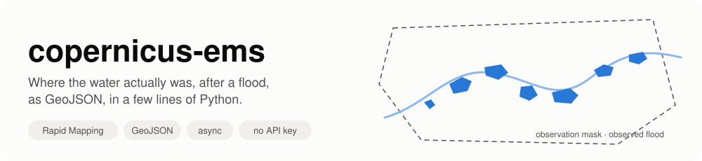
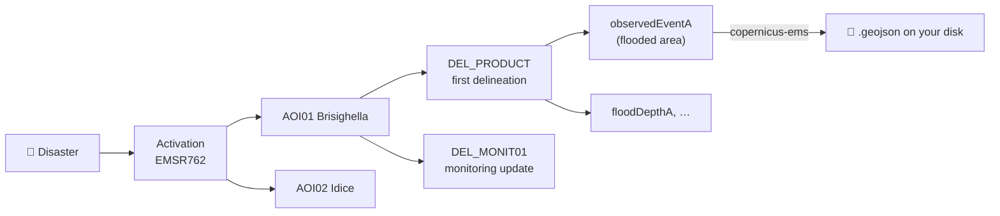
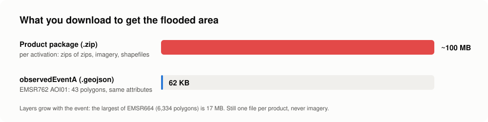
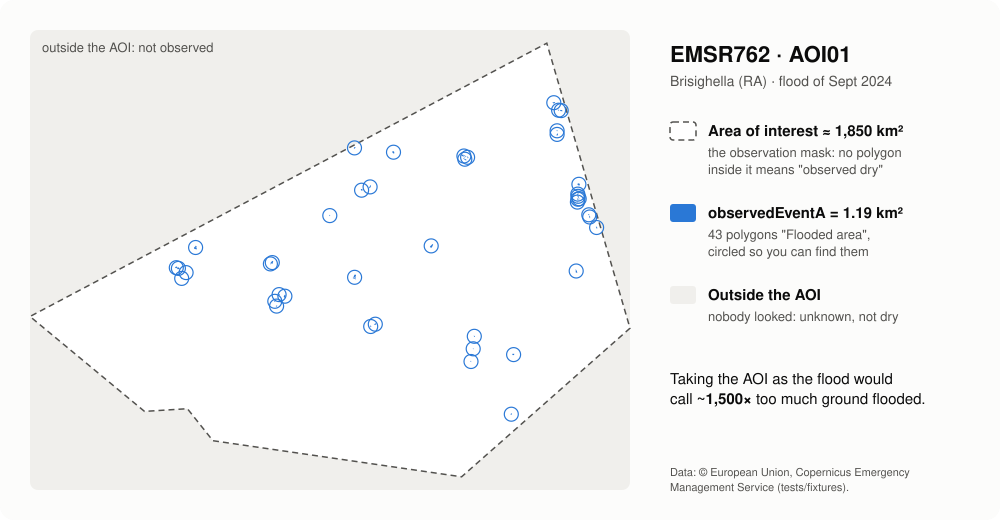
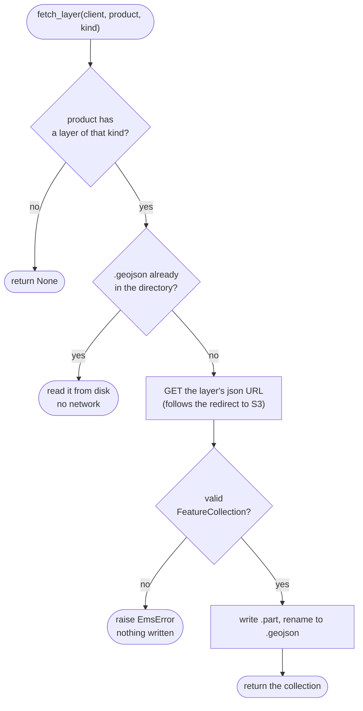
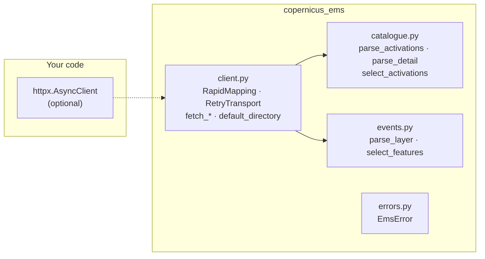

<p align="center">
  
</p>

<p align="center">
  <a href="https://github.com/agent-engineering-studio/copernicus-ems/actions/workflows/ci.yml"></a>
  <a href="https://agentengineering.it/copernicus-ems/"></a>
  <a href="https://pypi.org/project/copernicus-ems/"></a>
  
  
  <a href="./LICENSE"></a>
</p>

**copernicus-ems** is a small, typed, async Python library for
[Copernicus EMS Rapid Mapping](https://rapidmapping.emergency.copernicus.eu/),
the service that maps floods, fires, landslides and earthquakes from
satellite images within hours of a disaster. It reads the **activations**,
their **products**, and the **observed event layers** (flooded areas, burnt
areas, landslides…) as GeoJSON, together with the **observation masks**
that make them usable as ground truth.

```python
async with RapidMapping() as ems:
    events = await ems.observed_events("EMSR664")  # Emilia-Romagna, May 2023
# 6,334 flood polygons in 11 products, saved in ~/.cache/copernicus-ems/EMSR664/
```

No account, no API key: the dashboard API is public. One dependency: `httpx`.

📖 **Documentation, API reference and roadmap (AI included):**
<https://agentengineering.it/copernicus-ems/>

---

## Contents

- [What is Rapid Mapping, in 30 seconds](#what-is-rapid-mapping-in-30-seconds)
- [What this library does](#what-this-library-does)
- [Quick start](#quick-start)
- [Where downloads are saved](#where-downloads-are-saved) · [Docker](#in-docker)
- [How it works](#how-it-works)
- [Recipes](#recipes)
- [The traps we already fell into](#the-traps-we-already-fell-into)
- [API at a glance](#api-at-a-glance)
- [Limits](#limits)
- [Contributing](#contributing)
- [Data licence and credits](#data-licence-and-credits)

---

## What is Rapid Mapping, in 30 seconds

When a disaster strikes in Europe (or anywhere an authorised user asks),
the Copernicus Emergency Management Service is **activated**. Each
activation gets a code (`EMSR762`) and one or more **areas of interest**
(AOI). Analysts task satellites, and for each AOI they publish **products**:
a first map, then **monitoring** updates as the event evolves. Each product
holds vector **layers**; the one that says *where the event actually was*
is `observedEventA`.



Rapid Mapping is the best open record of **where water actually was** after
a flood in Europe: dated, delineated from satellite images, with an open
licence.

## What this library does

| | Feature | In plain words |
|---|---|---|
| 🔎 | **Activations** | Every public activation, filtered by country and category. |
| 🗺️ | **Products and observation masks** | Each product with its label, the time the satellite saw the event, and the AOI that was looked at. |
| 🌊 | **Observed events as GeoJSON** | The flooded polygons of each product, filtered to real floods (no landslides, no AOI). |
| 💾 | **Disk cache, in a predefined folder** | Layers are saved once; a second run reads them from disk. One environment variable moves the folder to a Docker volume. |
| 🔁 | **Self-contained** | `RapidMapping()` opens its own HTTP client, retries 502s and network errors, closes it at the end. |
| 🧪 | **Pure functions too** | Every parsing step is a plain function, if you have your own HTTP stack. |

### Why a library, and not the product package

The obvious way to read Rapid Mapping is the expensive and fragile one:

| The obvious way | What this does instead |
|---|---|
| download `{code}_products.zip` (~100 MB per activation, zips of zips, ortho imagery) and read shapefiles | read each product's vector layer as **GeoJSON**, the same features |
| some product packages answer **403** (EMSR664, Emilia-Romagna, May 2023) | their GeoJSON layers are open: EMSR664 alone is 6,334 flood polygons |
| take the **area of interest** as the event | take `observedEventA`: on EMSR762 AOI01 the AOI is ~1,850 km², the flood 1.19 km² |
| filter activations on category `Flood` | many Italian floods are filed as `Storm`: filter features on `event_type` |
| keep every feature of a flood activation | the same rain's landslides are in it too (`6-Mass Movement`) |

<p align="center">
  
</p>

The GeoJSON layers were checked against the shapefiles of the product
packages on 77 layers from 10 Italian activations: same features, same
attributes, same area.

### Who is it for

- **Hydrologists and flood modellers** who need observed extents to
  validate a forecast or a hazard map.
- **GIS and data engineers** who want every flood of a country, repeatably,
  without clicking through the viewer.
- **ML practitioners** who need labelled flood / not-flood areas, with the
  mask that says where "not flooded" was actually observed.

It started inside [Limen](https://github.com/agent-engineering-studio/limen),
where the observed flood extents are the ground truth of a flood backtest,
and was extracted so that anyone can use it.

---

## Quick start

### 1. Install

```bash
pip install copernicus-ems
```

Python 3.12 or newer. No key to create, nothing to configure.

### 2. Get the floods of an activation

```python
import asyncio

from copernicus_ems import RapidMapping


async def main() -> None:
    async with RapidMapping() as ems:
        italy = await ems.activations(country="Italy", categories=["Flood", "Storm"])
        print(len(italy), "activations in Italy, first", italy[0].code, italy[0].event_time.date())

        events = await ems.observed_events("EMSR664")
        for e in events[:3]:
            print(e.product.label, e.product.observed_time, len(e.features), "polygons")
        print(sum(len(e.features) for e in events), "flood polygons in", len(events), "products")
        print("saved in", ems.directory)


asyncio.run(main())
```

```text
14 activations in Italy, first EMSR659 2023-05-02
AOI01_DEL_MONIT01 2023-05-18 16:55:00+00:00 462 polygons
AOI01_GRA_PRODUCT 2023-05-22 10:27:00+00:00 92 polygons
AOI01_DEL_PRODUCT 2023-05-17 16:56:00+00:00 1153 polygons
6334 flood polygons in 11 products
saved in /home/you/.cache/copernicus-ems
```

Run it again: the 11 layers are read from disk and the only request left is
the activation detail (12.7 s the first time, 2.1 s the second, on
EMSR664).

### 3. From the command line

The package installs a `copernicus-ems` command (also `python -m copernicus_ems`):

```bash
copernicus-ems list --country Italy --since 2025-01-01        # code, date, category, name
copernicus-ems list --category Flood --json                   # one JSON object per line
copernicus-ems fetch EMSR762 EMSR664                          # layers into the cache
copernicus-ems export --country Italy -o italy.geojson --masks italy_masks.geojson
copernicus-ems export EMSR762 -o emsr762.geojson --all-events # landslides too
copernicus-ems export EMSR664 -o emsr664.parquet              # GeoParquet ([parquet] extra)
```

`export` tags every feature with its `activation`, `product`, `aoi_name`
and `observed_time`; `--masks` writes the observation mask of each product
as a second GeoJSON. By country it reads the `Flood` and `Storm`
activations (`--category` to change it), and keeps the flood features.
`--dir` sets where the layers are saved.

### 4. Every flood of a country, from Python

[`examples/italy_floods.py`](examples/italy_floods.py) writes one GeoJSON
with every flood polygon of a country, each tagged with its activation,
product and observation time:

```bash
uv run python examples/italy_floods.py              # -> italy_floods.geojson
uv run python examples/italy_floods.py Spain spain.geojson
```

```text
EMSR659 2023-05-02   1195  Flood in Emilia-Romagna, Italy
EMSR664 2023-05-16   6334  Flood in Italy
EMSR705 2023-11-02   1370  Flood in Tuscany region, Italy
...
EMSR871 2026-03-31   1015  Flood in Abruzzo, Molise and Basilicata regions, Italy
15620 polygons from 14 activations; cache: /home/you/.cache/copernicus-ems
```

Open the result in QGIS or drop it on [geojson.io](https://geojson.io).

---

## Where downloads are saved

The GeoJSON layers are saved in a directory, which is also the cache. If
you don't pass one (`RapidMapping(directory=...)`, or `directory=` on the
functions):

1. `COPERNICUS_EMS_DATA_DIR`, if set;
2. otherwise `~/.cache/copernicus-ems` (or `$XDG_CACHE_HOME/copernicus-ems`).

```text
$COPERNICUS_EMS_DATA_DIR/
├── EMSR664/
│   ├── EMSR664_AOI01_DEL_PRODUCT_observedEventA_v1.geojson
│   ├── EMSR664_AOI01_DEL_MONIT01_observedEventA_v1.geojson
│   └── …
└── EMSR762/
    └── EMSR762_AOI01_DEL_PRODUCT_observedEventA_v1.geojson
```

Every flood mapped in Italy since 2023 takes about **200 MB** (14
activations, November 2026). Each file is a plain GeoJSON
FeatureCollection, exactly as Rapid Mapping publishes it: you can open the
folder in QGIS directly.

### In Docker

In a container, point the variable at a **persistent volume**, or the cache
is lost with the container and every start downloads everything again:

```yaml
services:
  app:
    environment:
      COPERNICUS_EMS_DATA_DIR: /data/copernicus-ems
    volumes:
      - ems-data:/data/copernicus-ems   # named volume
      # or a host folder:  - ./data/copernicus-ems:/data/copernicus-ems
volumes:
  ems-data:
```

With [Limen](https://github.com/agent-engineering-studio/limen), next to its
other datasets under `LIMEN_DATA_ROOT`:

```yaml
    environment:
      COPERNICUS_EMS_DATA_DIR: /var/lib/limen/copernicus-ems
    volumes:
      - ${LIMEN_DATA_ROOT:-../../data}/copernicus-ems:/var/lib/limen/copernicus-ems
```

The folder is created if missing; the container user must be able to write
it.

---

## How it works

### The observation mask: why the AOI is not the flood

<p align="center">
  
</p>

Real data from [`tests/fixtures/`](tests/fixtures/). Each product splits
the map in three:

| Where | What it means | In the library |
|---|---|---|
| inside an `observedEventA` polygon | **observed flooded** | `ProductEvents.features` |
| inside the AOI, no polygon | **observed dry** | `Product.aoi_extent_wkt` minus the features |
| outside the AOI | **not observed**: unknown | — |

So a model that predicted a flood outside every AOI has not raised a false
alarm: nobody looked. Inside the AOI and outside the polygons, it has.

### Which time to use

An activation has an `event_time`; each product has an `observed_time`, the
earliest satellite image it was made from. Use **`observed_time`** to say
*when the water was seen*: anchoring a forecast lead time to `event_time`
would credit hours in which the flood was already happening.

```mermaid
timeline
    title EMSR664, AOI01 (May 2023)
    16 May : event_time (activation)
    17 May 16:56 : DEL_PRODUCT observed, 1153 polygons
    18 May 16:55 : DEL_MONIT01 observed, 462 polygons
    22 May 10:27 : GRA_PRODUCT observed, 92 polygons
```

### What `fetch_layer` decides



A layer's file name carries its version (`…_observedEventA_v2`): when
Rapid Mapping corrects a layer, the new version gets a new file, so a file
in the cache is never stale. The activation list and details are **not**
cached: new monitoring products appear in them. And because a file is
first written as `.part` and then renamed, an interrupted run never leaves
a half-written layer behind.

### The building blocks



- **`catalogue.py`, `events.py`**: pure functions, no network. They build
  URLs and read answers.
- **`client.py`**: the `fetch_*` functions wire them to **your**
  `httpx.AsyncClient`; `RapidMapping` brings its own, with retries.

### Products and features

Each `Product` carries:

- `label`: `AOI01_DEL_PRODUCT`, `AOI02_DEL_MONIT01`: delineation (`DEL`),
  grading (`GRA`) or first estimate (`FEP`), then each monitoring update;
- `observed_time`: the earliest satellite image it was made from;
- `aoi_extent_wkt`: the **observation mask**, as WKT (lon/lat);
- `layers`: every vector layer by kind (`observedEventA`, `floodDepthA`,
  `maximumFloodExtentA`, …), the latest version of each.

Features are GeoJSON in CRS84 (lon/lat WGS84), with the Rapid Mapping
attributes:

```json
{
  "event_type": "5-Flood",
  "notation": "Flooded area",
  "obj_desc": "Riverine flood",
  "det_method": "Semi-automatic extraction",
  "area": 9.525881
}
```

`select_features` keeps `5-Flood` with "Flooded area" and "Flood trace" by
default; pass `event_types=None, notations=None` for everything.

---

## Recipes

### Your own HTTP client

Timeouts, proxies, retries stay yours; `RapidMapping` leaves your client
open:

```python
async with httpx.AsyncClient(timeout=120, proxy="http://proxy:3128") as client:
    ems = RapidMapping(client, directory=Path("data/ems"))
    events = await ems.observed_events("EMSR762")
```

Or the functions directly, without the class:

```python
from copernicus_ems import fetch_layer, fetch_observed_events, fetch_products

events = await fetch_observed_events(client, "EMSR762", directory=Path("data/ems"))
products = await fetch_products(client, "EMSR762")
depth = await fetch_layer(client, products[0], "floodDepthA")  # None if absent
```

### Other hazards: landslides, everything

```python
landslides = await ems.observed_events("EMSR762", event_types=["6-Mass Movement"], notations=None)
everything = await ems.observed_events("EMSR762", event_types=None, notations=None)
```

### The observation mask as a geometry

```python
import shapely  # pip install shapely
from shapely.geometry import shape

mask = shape(event.product.aoi_extent)  # GeoJSON; or shapely.from_wkt(aoi_extent_wkt)
flooded = shapely.union_all([shape(f["geometry"]) for f in event.features])
observed_dry = mask.difference(flooded)
```

### Areas, label rasters, scores (`[geo]`, `[ml]` extras)

```python
from copernicus_ems.geo import summary  # pip install 'copernicus-ems[geo]'
from copernicus_ems.ml import evaluate, rasterize  # pip install 'copernicus-ems[ml]'

for s in summary(events):
    print(s.product, f"{s.flooded_km2:.2f} km² flooded of {s.observed_km2:.1f} observed")

labels = rasterize(events[0], resolution_m=20)  # 1 flooded, 0 dry, 255 not observed
scores = evaluate(my_prediction, labels)  # CSI, POD, FAR only inside the AOI
```

A model that predicts water outside the AOI is not penalised: nobody
looked. Details: [Geometry & ML](https://agentengineering.it/copernicus-ems/ml/).

### Open imagery to pair with the labels

```bash
copernicus-ems scenes EMSR664 --aoi 1 --optical --max-cloud 30
```

Products are often made from commercial images (`Product.images`); this
finds the nearest open **Sentinel-1/2** passes over each AOI in the
Copernicus Data Space catalogue, with the time gap and the share of the
AOI they cover. Searching needs no account, downloading does. Details:
[Open imagery](https://agentengineering.it/copernicus-ems/scenes/).

### Sentinel-1 backscatter on the labels' grid (`[cdse]` extra)

With a free Copernicus Data Space account (`CDSE_CLIENT_ID` /
`CDSE_CLIENT_SECRET`, or `CDSE_CREDENTIALS_FILE` for a Docker secret):

```bash
copernicus-ems pairs EMSR664 --dry-run   # the plan and its processing units, free
copernicus-ems pairs EMSR664 --aoi 3     # VV, VH on exactly the label grid, + labels + manifest
copernicus-ems pairs EMSR664 --reference # + a pre-event pass of the same orbit (change detection)
```

For each product it picks the nearest Sentinel-1 pass covering the AOI,
asks the Sentinel Hub Process API for calibrated, orthorectified
backscatter cut to the labels' grid, and writes image, labels and a
`_pair.json` (time gap, coverage, credits) into the data directory, the
same Docker volume as the layers. Then, offline and free:

```bash
copernicus-ems dataset -o ./floods-s1 --size 256   # chips, index.csv, train/val/test by area
```

Details:
[Sentinel-1 backscatter](https://agentengineering.it/copernicus-ems/backscatter/).

### A flood detector, trained and scored on EMS

[`notebooks/01_flood_segmentation_s1.ipynb`](notebooks/01_flood_segmentation_s1.ipynb)
goes from the Italian floods mapped since 2023 to two Sentinel-1 flood
detectors (a VV threshold and a per-pixel classifier), split by area and
scored only where EMS observed. About 94 PU the first time, nothing after.
On labels drawn on the same Sentinel-1 image the threshold reaches CSI 0.39;
on labels from other sensors both detectors stay under CSI 0.1 — the honest
baseline for the next models.
[`notebooks/02_change_detection_s1.ipynb`](notebooks/02_change_detection_s1.ipynb)
adds a pre-event pass of the same orbit (`pairs --reference`): change
detection lifts the same-image CSI to 0.42 on one split.
[`notebooks/03_cross_validation_s1.ipynb`](notebooks/03_cross_validation_s1.ipynb)
scores every flood once, leaving its activation out (0 PU): on 130 km² of
labels from other sensors the VV threshold reaches CSI 0.12, change
detection does not beat it, and false alarms (bias 2–7) are the problem.
See [Notebooks](https://agentengineering.it/copernicus-ems/notebooks/).

### Ask an agent (MCP server, `[mcp]` extra)

```bash
pip install 'copernicus-ems[mcp]'
claude mcp add copernicus-ems -- copernicus-ems mcp
```

Claude (or any MCP client) gets five tools: `list_activations`,
`activation_summary`, `compare_products`, `export_observed_events`,
`find_scenes`. They
answer with computed facts (km², observation times, per AOI) and file
paths, never thousands of polygons. Details:
[MCP server](https://agentengineering.it/copernicus-ems/mcp/).

### Handle errors

```python
from copernicus_ems import EmsError

try:
    events = await ems.observed_events("EMSR762")
except EmsError as exc:
    # Rapid Mapping answered, but not with what was asked (HTML, not GeoJSON…)
    print("Rapid Mapping said no:", exc)
except httpx.HTTPError as exc:
    # Network problems and HTTP errors, after the retries of RapidMapping
    print("network:", exc)
```

### Bring your own HTTP (sync example)

No `asyncio`? Every parsing step is a plain function:

```python
import httpx

from copernicus_ems import detail_url, parse_detail, parse_layer, select_features

with httpx.Client(timeout=60, follow_redirects=True) as http:
    products = parse_detail(http.get(detail_url("EMSR762")).content)
    for product in products:
        if (layer := product.layers.get("observedEventA")) is not None:
            floods = select_features(parse_layer(http.get(layer.url).content))
            print(product.label, len(floods))
```

---

## The traps we already fell into

The Rapid Mapping viewer is built for clicking. The API behind it works,
but the parts that matter are undocumented, and each one fails **quietly**:

| You try | What actually happens | What copernicus-ems does |
|---|---|---|
| the product package (`_products.zip`) | ~100 MB of zips of zips, and **403** for some activations (EMSR664) | reads the open GeoJSON layers |
| the AOI as the flooded area | ~1,500× too large on EMSR762 AOI01 | reads `observedEventA`, keeps the AOI as the mask |
| category `Flood` | many Italian floods are `Storm` (EMSR928, EMSR930) | filters features on `event_type` |
| every feature of a flood activation | the landslides the same rain triggered are in it | keeps `5-Flood` by default |
| `event_time` as the time of the observation | it is when the event started, hours or days before the image | `Product.observed_time` |
| `countries` from list and detail | strings in the list, `{"name": …}` in the detail | normalises both |
| an older layer version | the API lists every version (`_v1`, `_v2`) | keeps the latest of each kind |
| the dashboard API, many times in a row | **502** now and then | `RapidMapping` retries with backoff |

---

## API at a glance

| Name | What it does |
|---|---|
| `RapidMapping(client=None, *, directory=None, retries=3)` | The async client; async context manager. |
| `.activations(country=, categories=, since=, until=)` | Public activations, oldest first. |
| `.products(code)` | The products of an activation. |
| `.layer(product, kind)` | One layer as GeoJSON (cached), or `None`. |
| `.observed_events(code, event_types=, notations=, concurrency=4)` | Selected features of each product, layers downloaded in parallel. |
| `Product.aoi_extent` | The observation mask as a GeoJSON geometry (`aoi_extent_wkt` as WKT). |
| `copernicus-ems list / fetch / export` | The command line. |
| `default_directory()` | Where layers go when no directory is given. |
| `ENV_DATA_DIR` | `"COPERNICUS_EMS_DATA_DIR"`. |
| `fetch_activations` · `fetch_products` · `fetch_layer` · `fetch_observed_events` | The same, as functions over your client. |
| `RetryTransport` | The retrying `httpx` transport `RapidMapping` uses. |
| `EmsError` | The service answered with something that is not what was asked. |

Lower level, for your own HTTP layer: `activations_url` /
`parse_activations` / `select_activations`, `detail_url` / `parse_detail`,
`parse_layer` / `select_features`, `layer_path`, `parse_time`, `wkt_to_geojson`.

---

## Limits

- The public API lists activations **from 2023**; older ones live on the
  legacy site, with no documented API.
- Satellite delineation is a lower bound: short urban floods and water
  under canopy may not show. A false alarm measured against it may be an
  event nobody saw.
- Activations are not only European: filter on `country`.

---

## Contributing

Contributions of every size are welcome, from a typo to a new feature.

```bash
git clone https://github.com/agent-engineering-studio/copernicus-ems
cd copernicus-ems
uv sync          # install everything, dev tools included
make check       # ruff + mypy --strict + pytest, the same gate as CI
```

The tests **do not need the network**: they run against recorded answers
of the real API in [`tests/fixtures/`](tests/fixtures/), and write only to
a temporary folder. Because the API is undocumented, a separate set of
**contract tests** asks the live services the same questions every Monday
([`live.yml`](.github/workflows/live.yml)) and opens an issue if their
answers change shape:

```bash
COPERNICUS_EMS_LIVE=1 uv run pytest -m live --no-cov
```

```text
copernicus-ems/
├── src/copernicus_ems/
│   ├── catalogue.py   # activations, products, layers: pure functions
│   ├── events.py      # GeoJSON layers, feature selection: pure functions
│   ├── client.py      # fetch_*, RapidMapping, cache, retries
│   └── errors.py      # EmsError
├── examples/
│   └── italy_floods.py
├── docs/images/       # the pictures of this README
└── tests/
    └── fixtures/      # real API answers, for offline tests
```

Rules are short: see [CONTRIBUTING.md](./CONTRIBUTING.md). Commits follow
[Conventional Commits](https://www.conventionalcommits.org/), coverage stays
above 90%, and contributions are accepted under Apache-2.0.

### Ideas to work on

| Idea | Why it matters | Good for |
|---|---|---|
| 🔥 **Presets for other hazards** (burnt areas, landslides) | Same API, other events | intermediate |
| 📊 **Area statistics and GeoParquet export** (`[geo]` extra) | Numbers and files for GIS and ML | intermediate |
| 🧪 **Fine-tuning notebook** on an EO foundation model | `pairs` → a flood model, scored with `evaluate` | advanced |
| 📈 **Statistical API water time series** (CDSE) | Water between EMS maps, for Limen | intermediate |
| 🏛️ **Legacy activations** (before 2023) | Ten more years of floods | advanced |

---

## Data licence and credits

Rapid Mapping data is © European Union, Copernicus Emergency Management
Service, free to use with attribution. Anything you publish from these
layers **must credit the source**, for example:

> Contains modified Copernicus Emergency Management Service information, © European Union.

The test fixtures, and the map in this README, are small Rapid Mapping
responses under the same terms. The banner is an illustration.

Code: [Apache-2.0](./LICENSE). Extracted from
[Limen](https://github.com/agent-engineering-studio/limen).

If this project is useful to you, a ⭐ on GitHub helps others find it.
