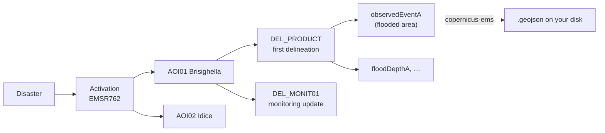
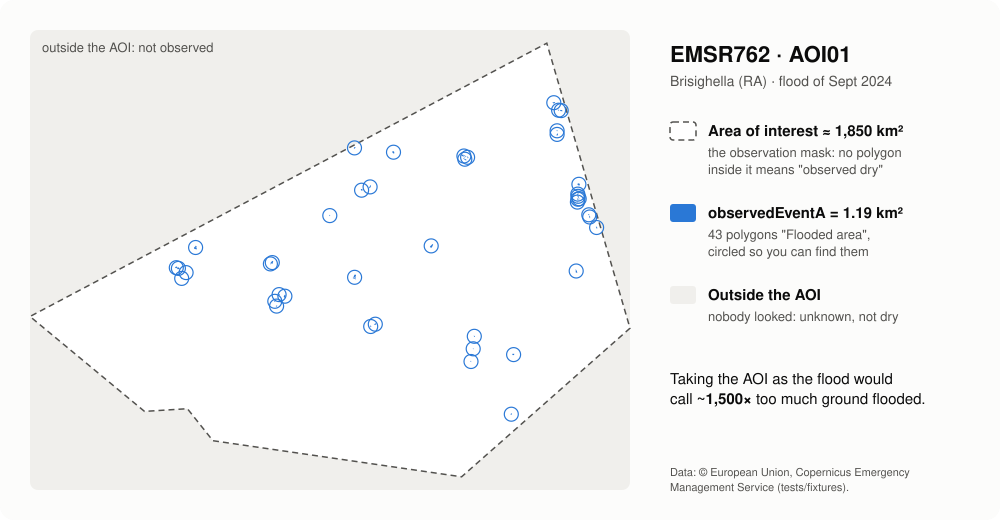
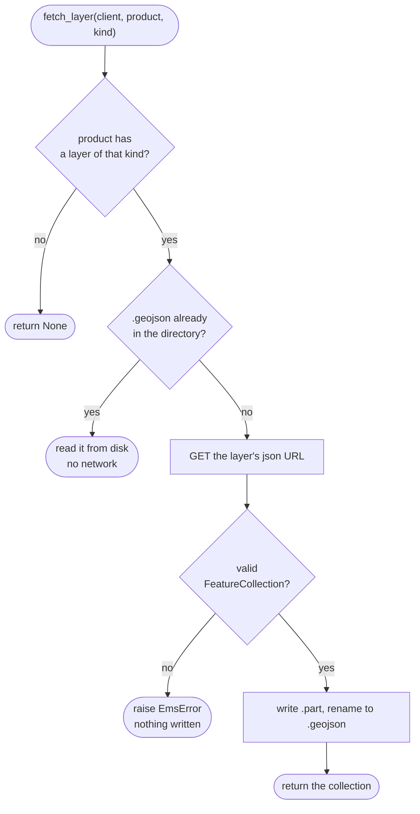
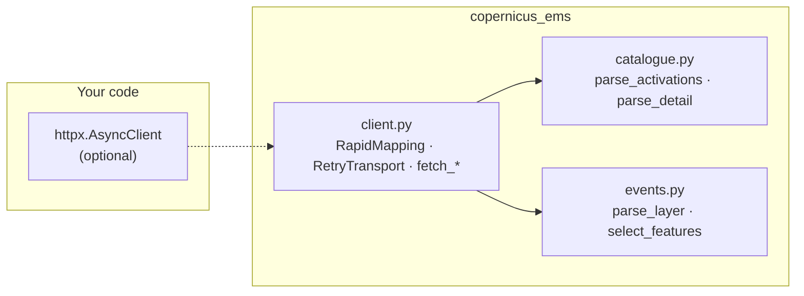

# How it works

## Rapid Mapping in 30 seconds

When a disaster strikes, the Copernicus Emergency Management Service is
**activated**. Each activation gets a code (`EMSR762`) and one or more
**areas of interest** (AOI). For each AOI analysts publish **products**: a
first map, then **monitoring** updates. Each product holds vector
**layers**; the one that says *where the event actually was* is
`observedEventA`.



## The observation mask: why the AOI is not the flood



| Where | What it means | In the library |
|---|---|---|
| inside an `observedEventA` polygon | **observed flooded** | `ProductEvents.features` |
| inside the AOI, no polygon | **observed dry** | `Product.aoi_extent_wkt` minus the features |
| outside the AOI | **not observed**: unknown | — |

A model that predicted a flood outside every AOI has not raised a false
alarm: nobody looked. Inside the AOI and outside the polygons, it has.

## Which time to use

An activation has an `event_time`; each product has an `observed_time`, the
earliest satellite image it was made from. Use **`observed_time`** to say
*when the water was seen*.

```mermaid
timeline
    title EMSR664, AOI01 (May 2023)
    16 May : event_time (activation)
    17 May 16:56 : DEL_PRODUCT observed, 1153 polygons
    18 May 16:55 : DEL_MONIT01 observed, 462 polygons
    22 May 10:27 : GRA_PRODUCT observed, 92 polygons
```

## What `fetch_layer` decides



A layer's file name carries its version (`…_observedEventA_v2`), so a file
in the cache is never stale. The activation list and details are **not**
cached: new monitoring products appear in them.

## The building blocks



## The traps we already fell into

| You try | What actually happens | What copernicus-ems does |
|---|---|---|
| the product package (`_products.zip`) | ~100 MB of zips of zips, and **403** for some activations | reads the open GeoJSON layers |
| the AOI as the flooded area | ~1,500× too large on EMSR762 AOI01 | reads `observedEventA`, keeps the AOI as the mask |
| category `Flood` | many Italian floods are `Storm` | filters features on `event_type` |
| every feature of a flood activation | the landslides of the same rain are in it | keeps `5-Flood` by default |
| `event_time` as the observation time | it is when the event started | `Product.observed_time` |
| `countries` from list and detail | strings in one, `{"name": …}` in the other | normalises both |
| an older layer version | the API lists every version | keeps the latest of each kind |
| the dashboard API, many times in a row | **502** now and then | `RapidMapping` retries with backoff |

## Limits

- The public API lists activations **from 2023**; older ones live on the
  legacy site, with no documented API.
- Satellite delineation is a lower bound: short urban floods and water
  under canopy may not show.
- Activations are not only European: filter on `country`.
