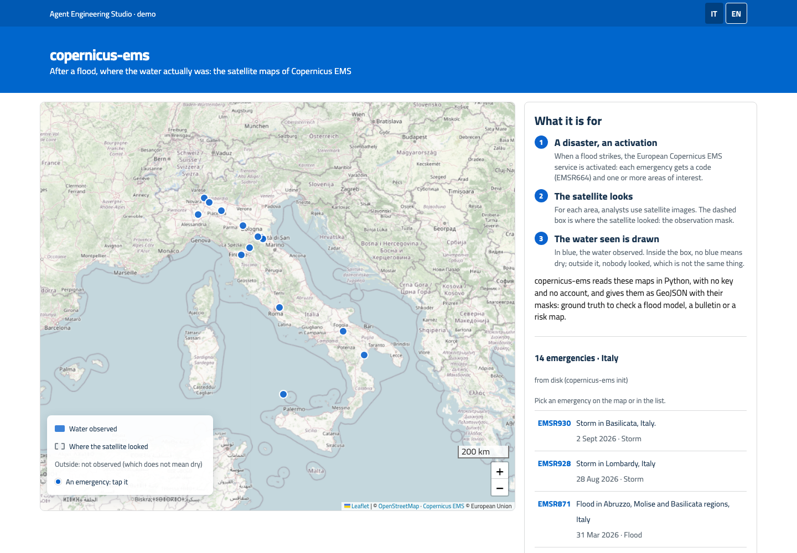
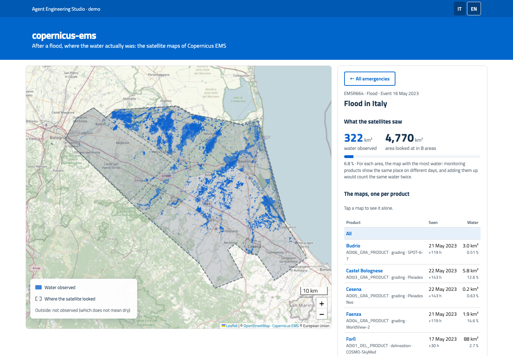

# The demo

A map of Italy that says, in three steps, what copernicus-ems is for. One dot
for each Copernicus EMS emergency (floods and storms, from 2023). Click one
and the map shows the dashed boxes where the satellites looked (the
observation masks) and, in blue, the water they saw. A card gives the same
numbers, product by product, and how far the radar backs each map. The
technical page (`/tecnica`) has the Python and the scores.





## Run it

With Docker, from the root of the repository:

```bash
docker compose run --rm init   # once: the floods of Italy, about 200 MB, into ./data
make docker                    # the demo, in the background, on http://localhost:3009
make up                        # + the MCP server for AI agents, on http://127.0.0.1:8769/mcp
make down                      # stop everything; the data stays
```

With [uv](https://docs.astral.sh/uv/) and [Node](https://nodejs.org/) 20 or
later:

```bash
make init    # install everything and download the floods of Italy
make demo    # the demo, on http://localhost:3009
```

Without `init` it works all the same, reading Rapid Mapping live: each layer
read is saved, so the second visit is fast.

`/?code=EMSR664` opens the page on that activation, to link to it.

## The two pages

**`/`, the plain page.** The map, the list and the card. In the card, a
**Radar** column says, for each product, how far the Sentinel-1 radar backs
the map: "il radar conferma", "da guardare" (worth a look: a person should
look at it), "non valutabile" or "non ancora controllata". With one product
selected, the map also shows where the radar and the map agree (blue), the
water only the map has (lighter blue) and, hatched orange, "possible water,
not mapped". A paragraph explains how far to trust a map. No scores, no code.
When `copernicus-ems describe` has run for the activation, the card also
shows its description, with a line under it saying a language model wrote it
from the official text and the library's numbers. Without the file, nothing
is shown.
The radar sees only part of the water, so "da guardare" only means a person
should look at the map: it is not a judgment on it.

On the same page, before the list, one panel answers a municipality: **the
water observed over its territory**. For each saved activation that looked at
the place it gives the km² of water and, as a bar, how much of the place was
observed, how much was found wet and how much nobody looked at. The boundary
is drawn on the map. Set it with `COPERNICUS_EMS_PLACE_GEOJSON` (a GeoJSON
file, lon/lat) and `COPERNICUS_EMS_PLACE` (its name); the default is Faenza.
The panel shows observed water and nothing else: no hazard layers, no risk,
no alert. See [Water over a place](places.md).

**`/tecnica`, the technical page** (link "Per chi sviluppa", it keeps
`?code=`). The numbers behind each word: the card's numbers and the Python
that gives them, one row per product of the radar check (verdict, flags, gap
in hours, independent, km² per class, CSI, POD, FAR, bias), the commands, the
files, the limits, and the MCP tools for AI agents. `/tecnica?code=EMSR664`
opens it on an activation. For the description it shows the official text, the
fields with their quotes, what was dropped and why, the provider, the model
and the date. See [Descriptions](describe.md).

## Where the radar results come from

The demo never fetches and never runs the detector: it reads the files that
`copernicus-ems quality` and `copernicus-ems radar` wrote beside each
Sentinel-1 pair, in `$DATA_ROOT/copernicus-ems/<CODE>/sentinel-1/`
(`*_quality.json`, `*_agreement.json`, `*_agreement.geojson`). A product with
none shows "non ancora controllata". Nothing is published with the data.

To make them (needs CDSE credentials and Processing Units):

```bash
make radar CODE=EMSR664   # quality --fetch, then radar, into $DATA_ROOT/copernicus-ems
```

Like the library, `make radar` writes into `$COPERNICUS_EMS_DATA_DIR` when it
is set, else into `$DATA_ROOT/copernicus-ems` (`data/copernicus-ems` by
default): the same directory the demo reads.

To see results at 0 PU, if you have the calibration pairs (the 24 Italian
maps of the notebooks, from their `ems-data` artifact), copy them in:

```bash
mkdir -p data/copernicus-ems/EMSR664
cp -R data/calibration/copernicus-ems/EMSR664/sentinel-1 data/copernicus-ems/EMSR664/
```

The files are read as they are and never changed. Details:
[Quality check](quality.md) and [Radar agreement](radar.md).

## What is in it

| Click | The page shows | From |
|---|---|---|
| the map, with nothing open | one dot per activation of the country | `read_activations`, `read_products` (`aoi_extent`) |
| a dot, or a row of the list | the masks and the water seen, the km² of each product | `RapidMapping.layer`, `select_features`, `geo.flooded`, `geo.area_km2` |
| a product in the card | that product alone on the map | the same, filtered |

The total of an activation takes, for each area, the product with the most
water: monitoring products show the same place on different days, and adding
them would count the same water twice.

The page is in Italian and in English: it opens in the language of the
browser, and **IT | EN** at the top changes it. The words are in
[`web/lib/i18n.ts`](https://github.com/agent-engineering-studio/copernicus-ems/blob/main/demo/web/lib/i18n.ts).

## How it is made

| Folder | What it is |
|---|---|
| [`api.py`](https://github.com/agent-engineering-studio/copernicus-ems/blob/main/demo/api.py) | a small API over the library (Starlette): the list, the card and the map of an activation |
| [`web/`](https://github.com/agent-engineering-studio/copernicus-ems/tree/main/demo/web) | the page (Next.js, Leaflet, [Bootstrap Italia](https://italia.github.io/bootstrap-italia/)): it draws the map and asks the API through its own `/api/*` |

Everything is read from the data directory (`$DATA_ROOT/copernicus-ems`)
first, and from Rapid Mapping when it is not there. The largest activations
are heavy (EMSR664: 1.7 million vertices), and joining their polygons takes
about half a minute. So each activation is prepared once, in a thread, and
kept in memory and in `$DATA_ROOT/copernicus-ems/demo/`. The key is the
layers' versions, so a new monitoring product is seen. At start, the API
prepares in the background every activation `init` saved. The map is
simplified to about 10 m and sent gzipped (EMSR664: 590 kB).

```bash
curl http://localhost:3009/api/health
curl http://localhost:3009/api/activations
curl http://localhost:3009/api/activation/EMSR762
curl http://localhost:3009/api/activation/EMSR762/map
curl http://localhost:3009/api/activation/EMSR762/radar
curl http://localhost:3009/api/activation/EMSR762/description
curl "http://localhost:3009/api/activation/EMSR762/radar/map?product=AOI01_GRA_PRODUCT"
```

| Variable | What it does | Default |
|---|---|---|
| `DATA_ROOT` | the data root; this library uses `$DATA_ROOT/copernicus-ems` | `./data` |
| `COPERNICUS_EMS_COUNTRY` | the country the page shows | `Italy` |
| `COPERNICUS_EMS_PORT` | the port of the page | `3009` |
| `COPERNICUS_EMS_PLACE_GEOJSON` | the boundary of the place of the panel "water over our territory": a GeoJSON file, lon/lat | `demo/place.example.geojson` (Faenza) |
| `COPERNICUS_EMS_PLACE` | the name shown for it | the `name` property of the file |
| `COPERNICUS_EMS_API_PORT` | the port of the API, without Docker | `8000` |
| `COPERNICUS_EMS_API` | where the page finds the API | `http://127.0.0.1:8000` |

This is a demo of a library, not an alert service. A satellite map is a lower
bound: for danger, the official word is the Civil Protection's.
