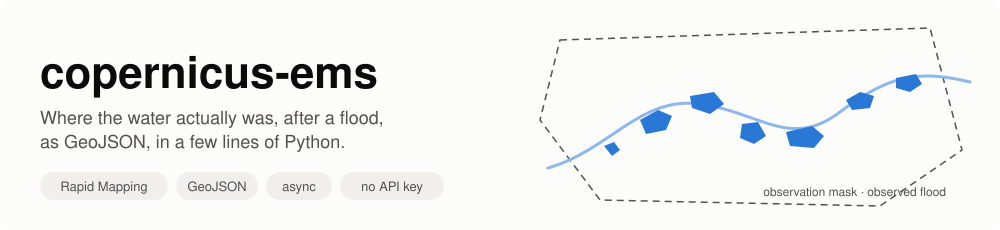
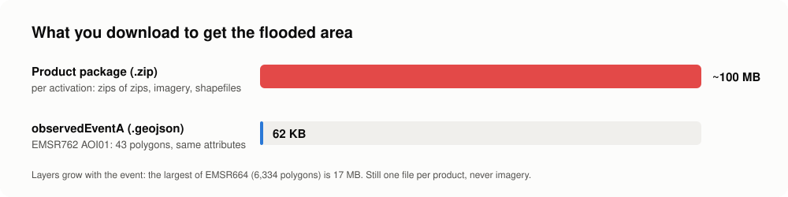

---
hide:
  - navigation
---

# copernicus-ems



**copernicus-ems** is a small, typed, async Python library for
[Copernicus EMS Rapid Mapping](https://rapidmapping.emergency.copernicus.eu/),
the service that maps floods, fires, landslides and earthquakes from
satellite images within hours of a disaster. It reads the **activations**,
their **products**, and the **observed event layers** (flooded areas, burnt
areas, landslides…) as GeoJSON, together with the **observation masks**
that make them usable as ground truth.

```python
async with RapidMapping() as ems:
    events = await ems.observed_events("EMSR664")  # Emilia-Romagna, May 2023
# 6,334 flood polygons in 11 products, saved in ~/.cache/copernicus-ems/EMSR664/
```

No account, no API key: the dashboard API is public. One dependency: `httpx`.

[Get started](getting-started.md){ .md-button .md-button--primary }
[See the roadmap](roadmap.md){ .md-button }

## What it does

| | Feature | In plain words |
|---|---|---|
| :mag: | **Activations** | Every public activation, filtered by country and category. |
| :world_map: | **Products and observation masks** | Each product with its label, the time the satellite saw the event, and the AOI that was looked at. |
| :ocean: | **Observed events as GeoJSON** | The flooded polygons of each product, filtered to real floods (no landslides, no AOI). |
| :floppy_disk: | **Disk cache** | Layers are saved once; a second run reads them from disk. One environment variable moves the folder to a Docker volume. |
| :repeat: | **Self-contained** | `RapidMapping()` opens its own HTTP client, retries 502s and network errors, closes it at the end. |
| :test_tube: | **Pure functions too** | Every parsing step is a plain function, if you have your own HTTP stack. |

## Why not the product package

| The obvious way | What this does instead |
|---|---|
| download `{code}_products.zip` (~100 MB per activation, zips of zips) and read shapefiles | read each product's vector layer as **GeoJSON**, the same features |
| some product packages answer **403** (EMSR664) | their GeoJSON layers are open: EMSR664 alone is 6,334 flood polygons |
| take the **area of interest** as the event | take `observedEventA`: on EMSR762 AOI01 the AOI is ~1,850 km², the flood 1.19 km² |
| filter activations on category `Flood` | many Italian floods are filed as `Storm`: filter features on `event_type` |
| keep every feature of a flood activation | the same rain's landslides are in it too (`6-Mass Movement`) |



## Who is it for

- **Hydrologists and flood modellers** who need observed extents to
  validate a forecast or a hazard map.
- **GIS and data engineers** who want every flood of a country, repeatably,
  without clicking through the viewer.
- **ML practitioners** who need labelled flood / not-flood areas, with the
  mask that says where "not flooded" was actually observed.

It started inside [Limen](https://github.com/agent-engineering-studio/limen),
where the observed flood extents are the ground truth of a flood backtest.

!!! note "Data licence"
    Rapid Mapping data is © European Union, Copernicus Emergency Management
    Service, free to use with attribution. Anything you publish from these
    layers must credit the source, for example: *Contains modified
    Copernicus Emergency Management Service information, © European Union.*
