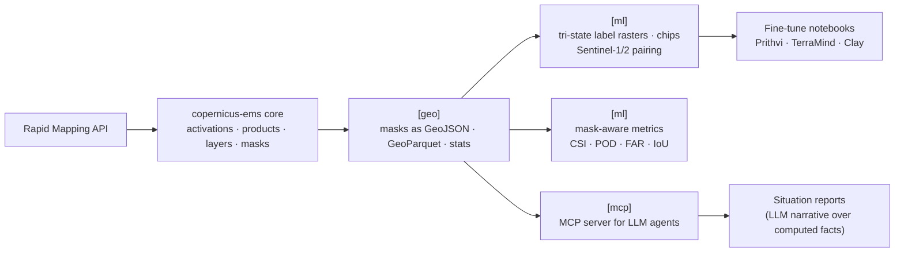
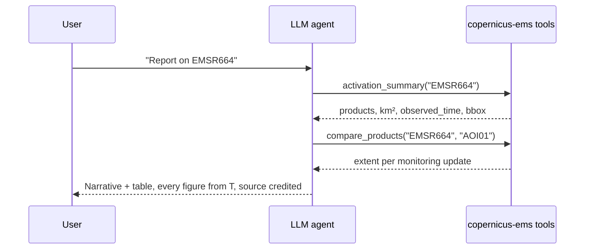

# Roadmap & AI

What copernicus-ems could become, and in which order. The library today
does one thing well: it turns Rapid Mapping into **trustworthy labelled
geometry** — observed flooded, observed dry, not observed, with the time
the satellite saw it. That is exactly the input most AI work on floods is
missing, so the AI features below build on it instead of beside it.

!!! info "Two rules for everything on this page"
    1. **The core stays small.** One dependency (`httpx`), typed, offline
       tests. AI and geo features arrive as **optional extras**
       (`copernicus-ems[geo]`, `[ml]`, `[mcp]`) or as separate packages,
       never as new hard dependencies.
    2. **Numbers are computed, never generated.** When a language model is
       involved, it orchestrates and explains; areas, counts, dates and
       metrics come from code over the real layers.

## Where the value is



## Priorities at a glance

| # | Feature | Kind | Impact | Effort | Target |
|---|---|---|---|---|---|
| 1 | CLI (`copernicus-ems fetch / list / export`) | core | high | S | 0.3 :white_check_mark: |
| 2 | Observation masks as GeoJSON, filter by date, parallel downloads | core | high | S | 0.3 :white_check_mark: |
| 3 | `[geo]` extra: area stats, GeoParquet export | geo | high | M | 0.3 / 0.4 :white_check_mark: |
| 4 | **Mask-aware evaluation metrics** for flood models | AI | very high | M | 0.4 :white_check_mark: |
| 5 | **Tri-state label rasters** and ML chips | AI | very high | M | 0.4 :white_check_mark: |
| 6 | **MCP server**: Rapid Mapping as tools for LLM agents | AI | high | S–M | 0.5 :white_check_mark: |
| 7 | **Sentinel-1/2 pairing** via Copernicus Data Space STAC | AI | very high | L | 0.3 :white_check_mark: (search; download needs an account) |
| 8 | Fine-tuning notebooks on EO foundation models | AI | medium | M | 0.6 |
| 9 | LLM situation reports from computed facts | AI | medium | M | later |
| 10 | Watch mode: new monitoring products → webhook / event | core | medium | M | later |
| 11 | Legacy activations (before 2023) | core | high | L | later |

S = days, M = one or two weeks, L = more.

---

## Foundations (0.3)

These are not AI, but every AI feature below needs them.

### Done

- **Command-line tool**: `copernicus-ems list / fetch / export`, `argparse`
  only, no new dependency; `export --masks` writes the observation masks
  too. See [Getting started](getting-started.md#from-the-command-line).
- **`Product.aoi_extent`**: the mask as a GeoJSON geometry, no shapely
  needed (`wkt_to_geojson`).
- **`activations(since=, until=)`**: a season, not the whole archive.
- **Parallel layer downloads**: `concurrency=4` by default, gentle on an
  API that already answers 502.
- **`MASS_MOVEMENT_EVENT_TYPE`** next to `FLOOD_EVENT_TYPE`.

### Still open

- **Typed features**: a `TypedDict` for the Rapid Mapping attributes
  (`event_type`, `notation`, `obj_desc`, `det_method`, `area`).
- **Burnt-area preset**: the wildfire `event_type` and notations, once
  checked on real wildfire activations (EMSR830, EMSR873).
- ~~GeoParquet output~~ for `export`: done in 0.4 (`parquet` extra).

### `[geo]` extra

With `shapely` and `pyarrow` installed:

- `observed_dry(event)` — the mask minus the flooded polygons;
- `summary(events)` — flooded km² per product, bbox, observation time;
- `to_geoparquet(...)` / `to_geopackage(...)` — one file per country,
  tagged with activation, product and `observed_time`, readable by
  GeoPandas, DuckDB and QGIS.

---

## AI features

### 1. Mask-aware evaluation metrics (0.4) — *the differentiator*

!!! success "Done"
    `copernicus_ems.ml.evaluate` / `evaluate_geometry`: see
    [Geometry & ML](ml.md#scoring-a-flood-model-only-where-someone-looked).

Every flood model (a forecast, a hazard map, a segmentation network) ends
up compared with observed extents. The common mistake is to score it on
the whole map, counting as false alarms the areas nobody observed. The
library already knows the three states; it should score with them.

```python
from copernicus_ems.ml import evaluate

scores = evaluate(prediction, events, resolution_m=20)
# scores.csi, scores.pod, scores.far, scores.iou — only inside the AOI
# scores.unobserved_predicted_km2 — reported, never counted as false alarm
```

- Input: a raster (`numpy` + transform) or polygons.
- Output: the contingency table **restricted to the observation mask**,
  per product and aggregated, with the `observed_time` each score refers
  to — so lead time is measured from when the water was seen.
- Why first: it is where [Limen](https://github.com/agent-engineering-studio/limen)
  already uses this data, the logic is small and testable offline, and no
  other open library does it.

### 2. Tri-state label rasters and ML chips (0.4)

!!! success "Done"
    `rasterize` and `chips`, saved as `.npy` with a JSON sidecar or as
    GeoTIFF (`to_geotiff`, `Chip.save(file_format="tif")`). See
    [Geometry & ML](ml.md).

Turn products into training data for segmentation models:

| Pixel value | Meaning | Source |
|---|---|---|
| `1` | flooded | inside an `observedEventA` polygon |
| `0` | dry | inside the AOI, no polygon |
| `255` | ignore | outside the AOI |

```python
from copernicus_ems.ml import rasterize, chips

label = rasterize(event, resolution_m=10, crs="EPSG:32633")
for chip in chips(label, size=512, min_flooded=0.01):
    chip.save("dataset/")  # GeoTIFF + JSON sidecar with provenance
```

The `255 = ignore` value maps directly to `ignore_index` in PyTorch losses,
so a model is never punished for "predicting water where nobody looked".
This is what makes Rapid Mapping a better label source than an AOI-only
dataset.

### 3. MCP server: Rapid Mapping for LLM agents (0.5)

!!! success "Done"
    `copernicus-ems mcp`, with the tools below (and `find_scenes`) and a
    `situation_report` prompt. See [MCP server](mcp.md).

Expose the library as a [Model Context Protocol](https://modelcontextprotocol.io/)
server, so an agent (Claude, or any MCP client) can answer questions such
as *"Which floods were mapped in Tuscany in 2024, and how large were they?"*
from the real data.

| Tool | Returns |
|---|---|
| `list_activations(country, since, until, categories)` | code, name, dates, category |
| `activation_summary(code)` | per product: label, `observed_time`, flooded km², polygon count, bbox |
| `compare_products(code, aoi)` | how the extent changed across monitoring updates |
| `export_observed_events(code, format)` | a path to a GeoJSON / GeoParquet file — **not** the polygons |

Design notes:

- Tools return **summaries and file paths**, never 6,000 raw polygons: an
  agent needs facts, not geometry dumps in its context.
- It reuses the disk cache, so repeated questions cost nothing.
- Shipped as `copernicus-ems[mcp]` (official `mcp` Python SDK) with a
  `copernicus-ems mcp` command, usable from Claude Desktop / Claude Code
  with one line of configuration.

### 4. Sentinel-1/2 pairing

!!! success "Done: finding the scenes"
    `find_scenes`, `passes`, `geo.coverage`, `copernicus-ems scenes` and
    the MCP tool `find_scenes`. See [Open imagery](scenes.md). Downloading
    and reading the rasters stay with the user (Data Space account,
    rasterio).

    Found on the way: products are mostly made from commercial images
    (`Product.images`), so the open scene is a *neighbour* in time, and the
    nearest one may cover a sliver of the AOI.

Labels are only half of a dataset. For each product, find the satellite
scene it was made from (or the nearest Sentinel-1 SAR / Sentinel-2
acquisition to `observed_time` over the AOI) through the
[Copernicus Data Space](https://dataspace.copernicus.eu/) STAC API, and
emit image + label pairs.

- SAR (Sentinel-1) first: it sees through clouds, which is why most flood
  maps are made from it.
- Output as a **STAC catalogue** so the dataset is reusable by any EO
  tooling.
- Large effort and new credentials (Data Space needs an account), so it
  belongs in a separate package or the `[ml]` extra, not in the core.

### 5. Fine-tuning notebooks on EO foundation models (0.6)

With pairs from (4) and labels from (2), show how to fine-tune an open
Earth-observation foundation model for flood segmentation — for example
[Prithvi](https://huggingface.co/ibm-nasa-geospatial),
TerraMind or Clay — and score it with the metrics of (1). This is
documentation, not library code: a notebook in `examples/`, compared with
the Sen1Floods11 baseline.

### 6. Situation reports from computed facts (later)

An LLM writes the narrative; the library supplies every number.



Guardrails: the report template cites each figure's tool call, always
includes the Copernicus attribution, and states the limits (delineation is
a lower bound; outside the AOI is unknown, not dry).

### What we would *not* do

| Idea | Why not |
|---|---|
| Embedding search over activations | A few hundred activations with structured fields: a filter is exact, an embedding is not. |
| An LLM to classify `Storm` vs `Flood` | `event_type` on the features already answers it, deterministically. |
| "Filling in" floods outside the AOI with a model | It would turn *unknown* into *invented* — the opposite of what the observation mask is for. Fine as research, never as data the library returns. |
| Generating geometry with an LLM | Geometry comes from analysts and satellites; models only consume it. |

---

## Operations and quality

- **Contract tests against the live API**, weekly in CI (not on every
  push): the API is undocumented and can change quietly; recorded
  fixtures would not notice.
- **Watch mode**: poll active activations, emit an event (webhook, file,
  MCP notification) when a new monitoring product appears.
- **Property-based tests** (Hypothesis) for the parsers.
- **Documentation**: this site, built from `docs/` and the docstrings on
  every push to `main`.

## Contributing

Each row of the priority table can become an issue. Items 1–2 are good
first contributions; 4 and 5 are the most valuable for the ML community.
See [CONTRIBUTING.md](https://github.com/agent-engineering-studio/copernicus-ems/blob/main/CONTRIBUTING.md).
