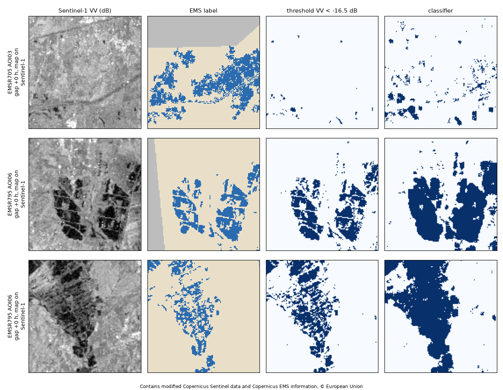
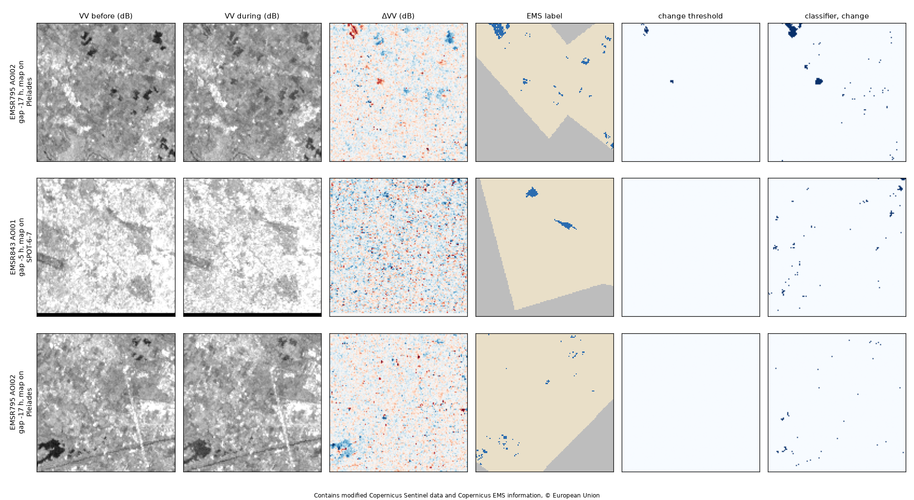
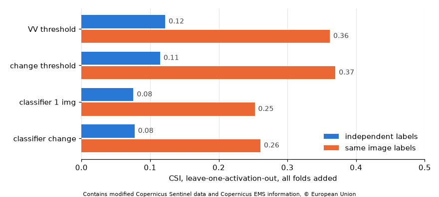

# Example notebooks

| Notebook | What it shows | Data | Cost |
|---|---|---|---|
| [`01_flood_segmentation_s1.ipynb`](https://github.com/agent-engineering-studio/copernicus-ems/blob/main/notebooks/01_flood_segmentation_s1.ipynb) | Every Italian flood mapped by Copernicus EMS since 2023 as labels, the nearest Sentinel-1 pass as image: a VV threshold and a per-pixel classifier, trained on some areas and scored on others, only where EMS observed | 8 activations, 23 Sentinel-1 images at 40 m | ~94 PU once, then nothing |
| [`02_change_detection_s1.ipynb`](https://github.com/agent-engineering-studio/copernicus-ems/blob/main/notebooks/02_change_detection_s1.ipynb) | The same floods with a pre-event Sentinel-1 pass of the same orbit: four detectors (VV threshold, change threshold, a classifier on one image or on the change) compared on the same chips, independent labels apart | the 23 images of 01 + one reference each | ~94 PU once (01's images are reused) |
| [`03_cross_validation_s1.ipynb`](https://github.com/agent-engineering-studio/copernicus-ems/blob/main/notebooks/03_cross_validation_s1.ipynb) | The four detectors of 02 scored by leave-one-activation-out cross-validation: each flood is the test once, tuned and trained on the others, all folds added | the pairs and references of 02 | 0 PU (reads the data directory) |

## Run them

```bash
pip install "copernicus-ems[cdse]" scikit-learn matplotlib jupyter
export CDSE_CLIENT_ID=sh-…  CDSE_CLIENT_SECRET=…     # Copernicus Data Space OAuth client
export COPERNICUS_EMS_DATA_DIR=~/copernicus-ems-data # where images and labels are kept (optional)
jupyter lab
```

or, from a clone, `uv sync --extra cdse --group notebooks`. The images are
kept in the data directory: a second run spends no processing units.

On GitHub, the **notebook** workflow (Actions → notebook → *Run workflow*,
choose the notebook) runs it with the repository's CDSE secrets, keeps the data directory in
the Actions cache, and uploads the executed notebook and its figure.

### Reuse the images elsewhere, at 0 PU

Each run of the workflow also uploads the data directory as the
`ems-data` artifact (kept 90 days): Sentinel-1 images, labels, pair
manifests and EMS layers, in the layout copernicus-ems expects. Download
it into another project's data directory (a Docker volume, for example)
and `pairs` / `make_pair` find the images there and send nothing:

```bash
gh run download <run id> -R agent-engineering-studio/copernicus-ems \
  -n ems-data -D "$COPERNICUS_EMS_DATA_DIR"
```

An image is reused only for the same request: same grid (AOI and
resolution, 40 m here) and same pass choice (`min_coverage`, `max_gap`,
`within` at their defaults). Labels are always rewritten locally, for free.

## Results of notebook 01

From the run of 4 November 2026 ([workflow run 41845923554](https://github.com/agent-engineering-studio/copernicus-ems/actions/runs/41845923554)):
48 EMS products, 24 with a Sentinel-1 pass close enough, 23 images
(93.7 PU the first time, 0 after), 404 chips of 128 px split by area:
train 283, val 60, test 61 (four areas: EMSR705/AOI03, EMSR795/AOI02,
EMSR795/AOI06, EMSR843/AOI01).

Test scores, only where EMS observed:

| Detector | Labels | Chips | CSI | POD | FAR | F1 | bias |
|---|---|---:|---:|---:|---:|---:|---:|
| VV < −16.5 dB | all | 61 | 0.376 | 0.526 | 0.431 | 0.546 | 0.92 |
| VV < −16.5 dB | independent | 28 | **0.037** | 0.058 | 0.906 | 0.072 | 0.62 |
| VV < −16.5 dB | same image | 33 | 0.394 | 0.548 | 0.417 | 0.565 | 0.94 |
| classifier | all | 61 | 0.286 | 0.670 | 0.667 | 0.445 | 2.01 |
| classifier | independent | 28 | **0.071** | 0.219 | 0.904 | 0.133 | 2.29 |
| classifier | same image | 33 | 0.299 | 0.692 | 0.655 | 0.461 | 2.00 |



**How to read them.** 8 of the 24 pairs have an EMS map drawn on the
*same* Sentinel-1 image the detectors see (gap ≈ 0 h): there the score
partly measures agreement with the EMS analyst's own reading of that
image, and it is good (CSI ≈ 0.39). On the labels drawn on other
sensors (optical, aerial, a different date) both detectors almost fail
(CSI 0.04–0.07): water under vegetation or in towns, flooding that
receded or arrived between the two acquisitions, and areas mapped as
flooded that radar sees as rough are not in one VV image. The headline
"all" score is carried by the same-image areas; quote the split scores,
not that one. The classifier, trained mostly on dry chips (1.1 %
flooded), over-predicts about twice the area: class weighting, a
pre-event reference scene and the DEM are the next steps, and the
same split is what a foundation model has to beat.

## Results of notebook 02

From [workflow run 41853533004](https://github.com/agent-engineering-studio/copernicus-ems/actions/runs/41853533004)
(4 November 2026): all 24 pairs found a reference of the same relative
orbit, 12 days before for 19 of them and 6 days before for 5, for 93.7 PU.
The chips and the test areas are the same as in notebook 01.

| Detector | Labels | CSI | POD | FAR | F1 | bias |
|---|---|---:|---:|---:|---:|---:|
| VV threshold | same image | 0.394 | 0.548 | 0.417 | 0.565 | 0.94 |
| change threshold (VV < −14 dB, ΔVV < −4 dB) | same image | **0.417** | 0.552 | 0.369 | 0.589 | 0.87 |
| classifier, one image | same image | 0.299 | 0.692 | 0.655 | 0.461 | 2.00 |
| classifier, change | same image | 0.361 | 0.763 | 0.593 | 0.531 | 1.88 |
| VV threshold | independent | 0.037 | 0.058 | 0.906 | 0.072 | 0.62 |
| change threshold | independent | 0.040 | 0.040 | 0.108 | 0.077 | 0.05 |
| classifier, one image | independent | 0.071 | 0.219 | 0.904 | 0.133 | 2.29 |
| classifier, change | independent | 0.032 | 0.196 | 0.963 | 0.062 | 5.31 |



**How to read them.**

- **Where the label shares the image, change helps.** The change
  threshold raises CSI from 0.39 to 0.42 and cuts false alarms (FAR 0.42 to
  0.37). The change classifier gains 0.06 CSI over the one-image classifier.
- **On independent labels it does not help.** The test maps were drawn on
  Pléiades, SPOT and WorldView optical images, and ΔVV shows hardly any
  change under most of their polygons. The water was shallow, short-lived
  or under cover, or it had receded in the 5–17 h between the two
  acquisitions. The change threshold becomes very cautious (bias 0.05,
  FAR 0.11): what it marks is mostly right, but it finds almost nothing.
- **Resolution is not the main cause.** Measured on the EMS polygons
  themselves, only 2.7 % of the independent flood area lies in polygons
  smaller than 4 pixels at 40 m (0.7 % at 20 m). The share is higher in the
  small test floods (19 % for EMSR795 AOI02, 44 % for EMSR843 AOI01 DEL),
  but most of their area is still in larger polygons.
- **The independent test is too small.** It holds about 2 km² of mapped
  flood, against 149 km² of independent labels in all. The large
  independent maps (EMSR664 AOI01 and AOI07, 109 km²) are all in training.
  The cross-validation of notebook 03 scores every area once.

## Results of notebook 03

Run locally on the `ems-data` of workflow run 41853533004 (5 November
2026), 0 PU: 404 chips, 7 folds (EMSR800 has no chip). Each activation
is scored by detectors tuned and trained without it; the contingency
tables of the folds are added. The independent labels now hold 129.7 km²
of mapped flood (2 km² in the fixed test of 02), the same-image ones
46.2 km².

| Detector | Labels | CSI | POD | FAR | F1 | bias |
|---|---|---:|---:|---:|---:|---:|
| VV threshold | independent | **0.122** | 0.330 | 0.838 | 0.218 | 2.03 |
| change threshold | independent | 0.115 | 0.396 | 0.861 | 0.206 | 2.85 |
| classifier, one image | independent | 0.076 | 0.552 | 0.919 | 0.141 | 6.84 |
| classifier, change | independent | 0.077 | 0.571 | 0.918 | 0.144 | 6.95 |
| VV threshold | same image | 0.362 | 0.487 | 0.416 | 0.531 | 0.83 |
| change threshold | same image | **0.370** | 0.466 | 0.358 | 0.540 | 0.73 |
| classifier, one image | same image | 0.252 | 0.723 | 0.721 | 0.403 | 2.59 |
| classifier, change | same image | 0.261 | 0.774 | 0.718 | 0.414 | 2.74 |

CSI per activation (independent labels):

| Activation | flooded km² | VV threshold | change threshold | classifier, one image | classifier, change |
|---|---:|---:|---:|---:|---:|
| EMSR664 | 111.2 | 0.116 | 0.109 | 0.070 | 0.073 |
| EMSR762 | 11.8 | 0.218 | 0.268 | 0.158 | 0.164 |
| EMSR705 | 5.3 | 0.219 | 0.216 | 0.188 | 0.156 |
| EMSR795 | 0.7 | 0.032 | 0.091 | 0.070 | 0.102 |
| EMSR843 | 0.6 | 0.075 | 0.041 | 0.036 | 0.011 |



**How to read them.**

- **On independent labels the baseline is CSI ≈ 0.12, not 0.04.** The fixed
  test of 02 was too small: scored on all 130 km², the VV threshold finds a
  third of the mapped water (POD 0.33).
- **False alarms are the problem, not missed water.** Every detector marks
  two to seven times the mapped area (bias 2–7, FAR 0.84–0.92). Out of their
  own activation, the thresholds and the classifiers are tuned on floods
  that look different.
- **Change detection does not help across activations.** The change
  threshold matches the VV threshold (0.115 vs 0.122 independent, 0.370 vs
  0.362 same image); the 0.42 of notebook 02 came from one split.
- **The classifiers generalise worst.** Trained on six activations, they
  over-predict on the seventh (bias ~7); per-activation calibration, class
  weights or terrain (DEM, HAND) to remove dark slopes and shadow are the
  next steps, before a finer grid or a bigger model.
- **One flood weighs most.** EMSR664 holds 111 of the 130 independent km²,
  so the pooled score is mostly its score (0.12); the smaller floods range
  from 0.01 to 0.27.

The notebooks are stored without outputs. Each one saves its figure in
`docs/images/`.

*Data: Copernicus EMS Rapid Mapping, © European Union; Copernicus Sentinel-1,
processed by Sentinel Hub on the Copernicus Data Space Ecosystem.*
